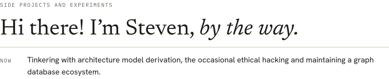
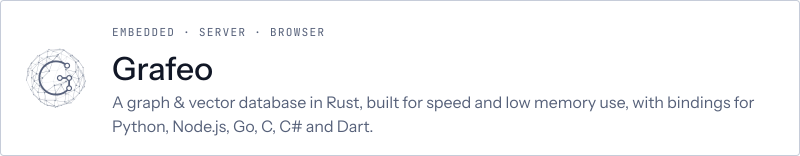
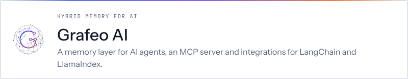
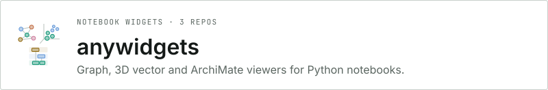
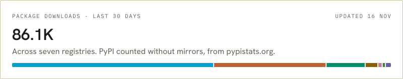

<!-- Each project banner links to its website, each repo chip under it to the repo.
     Visuals come in light and dark, and in narrow variants for README columns under 460px. GitHub's column
     narrows again at 768px and 1012px wide screens (sidebar), hence two ranges for narrow.
     Header, project banners and repo chips: uv run python -m visuals. -->
<picture>
  <source media="(max-width: 556px) and (prefers-color-scheme: dark), (min-width: 768px) and (max-width: 844px) and (prefers-color-scheme: dark)" srcset="assets/header-narrow-dark.svg">
  <source media="(max-width: 556px), (min-width: 768px) and (max-width: 844px)" srcset="assets/header-narrow-light.svg">
  <source media="(prefers-color-scheme: dark)" srcset="assets/header-dark.svg">
  
</picture>

## Projects

<!-- projects:start (generated by: uv run python -m visuals) -->
<a href="https://deriva.dev">
<picture>
  <source media="(max-width: 556px) and (prefers-color-scheme: dark), (min-width: 768px) and (max-width: 844px) and (prefers-color-scheme: dark)" srcset="assets/project-deriva-narrow-dark.svg">
  <source media="(max-width: 556px), (min-width: 768px) and (max-width: 844px)" srcset="assets/project-deriva-narrow-light.svg">
  <source media="(prefers-color-scheme: dark)" srcset="assets/project-deriva-dark.svg">
  
</picture>
</a>

<a href="https://github.com/StevenBtw/deriva"><picture><source media="(prefers-color-scheme: dark)" srcset="assets/repo-deriva-dark.svg"></picture></a>

<a href="https://grafeo.dev">
<picture>
  <source media="(max-width: 556px) and (prefers-color-scheme: dark), (min-width: 768px) and (max-width: 844px) and (prefers-color-scheme: dark)" srcset="assets/project-grafeo-narrow-dark.svg">
  <source media="(max-width: 556px), (min-width: 768px) and (max-width: 844px)" srcset="assets/project-grafeo-narrow-light.svg">
  <source media="(prefers-color-scheme: dark)" srcset="assets/project-grafeo-dark.svg">
  
</picture>
</a>

<a href="https://github.com/GrafeoDB/grafeo"><picture><source media="(prefers-color-scheme: dark)" srcset="assets/repo-grafeo-dark.svg"></picture></a>
<a href="https://github.com/GrafeoDB/grafeo-web"><picture><source media="(prefers-color-scheme: dark)" srcset="assets/repo-grafeo-web-dark.svg"></picture></a>
<a href="https://github.com/GrafeoDB/grafeo-server"><picture><source media="(prefers-color-scheme: dark)" srcset="assets/repo-grafeo-server-dark.svg"></picture></a>
<a href="https://github.com/GrafeoDB/grafeo-cuda"><picture><source media="(prefers-color-scheme: dark)" srcset="assets/repo-grafeo-cuda-dark.svg"></picture></a>
<a href="https://github.com/GrafeoDB/graph-bench"><picture><source media="(prefers-color-scheme: dark)" srcset="assets/repo-graph-bench-dark.svg"></picture></a>
<a href="https://github.com/GrafeoDB/boltr"><picture><source media="(prefers-color-scheme: dark)" srcset="assets/repo-boltr-dark.svg"></picture></a>
<a href="https://github.com/GrafeoDB/gql-wire-protocol"><picture><source media="(prefers-color-scheme: dark)" srcset="assets/repo-gwp-dark.svg"></picture></a>

<a href="https://grafeo.ai">
<picture>
  <source media="(max-width: 556px) and (prefers-color-scheme: dark), (min-width: 768px) and (max-width: 844px) and (prefers-color-scheme: dark)" srcset="assets/project-grafeo-ai-narrow-dark.svg">
  <source media="(max-width: 556px), (min-width: 768px) and (max-width: 844px)" srcset="assets/project-grafeo-ai-narrow-light.svg">
  <source media="(prefers-color-scheme: dark)" srcset="assets/project-grafeo-ai-dark.svg">
  
</picture>
</a>

<a href="https://github.com/GrafeoDB/grafeo-memory"><picture><source media="(prefers-color-scheme: dark)" srcset="assets/repo-grafeo-memory-dark.svg"></picture></a>
<a href="https://github.com/GrafeoDB/grafeo-mcp"><picture><source media="(prefers-color-scheme: dark)" srcset="assets/repo-grafeo-mcp-dark.svg"></picture></a>
<a href="https://github.com/GrafeoDB/grafeo-langchain"><picture><source media="(prefers-color-scheme: dark)" srcset="assets/repo-grafeo-langchain-dark.svg"></picture></a>
<a href="https://github.com/GrafeoDB/grafeo-llamaindex"><picture><source media="(prefers-color-scheme: dark)" srcset="assets/repo-grafeo-llamaindex-dark.svg"></picture></a>

<picture>
  <source media="(max-width: 556px) and (prefers-color-scheme: dark), (min-width: 768px) and (max-width: 844px) and (prefers-color-scheme: dark)" srcset="assets/project-anywidgets-narrow-dark.svg">
  <source media="(max-width: 556px), (min-width: 768px) and (max-width: 844px)" srcset="assets/project-anywidgets-narrow-light.svg">
  <source media="(prefers-color-scheme: dark)" srcset="assets/project-anywidgets-dark.svg">
  
</picture>

<a href="https://github.com/GrafeoDB/anywidget-graph"><picture><source media="(prefers-color-scheme: dark)" srcset="assets/repo-anywidget-graph-dark.svg"></picture></a>
<a href="https://github.com/GrafeoDB/anywidget-vector"><picture><source media="(prefers-color-scheme: dark)" srcset="assets/repo-anywidget-vector-dark.svg"></picture></a>
<a href="https://github.com/StevenBtw/anywidget-archimate"><picture><source media="(prefers-color-scheme: dark)" srcset="assets/repo-anywidget-archimate-dark.svg"></picture></a>

<a href="https://solvor.ai">
<picture>
  <source media="(max-width: 556px) and (prefers-color-scheme: dark), (min-width: 768px) and (max-width: 844px) and (prefers-color-scheme: dark)" srcset="assets/project-solvor-narrow-dark.svg">
  <source media="(max-width: 556px), (min-width: 768px) and (max-width: 844px)" srcset="assets/project-solvor-narrow-light.svg">
  <source media="(prefers-color-scheme: dark)" srcset="assets/project-solvor-dark.svg">
  
</picture>
</a>

<a href="https://github.com/StevenBtw/solvOR"><picture><source media="(prefers-color-scheme: dark)" srcset="assets/repo-solvor-dark.svg"></picture></a>
<a href="https://github.com/StevenBtw/benchmORk"><picture><source media="(prefers-color-scheme: dark)" srcset="assets/repo-benchmork-dark.svg"></picture></a>

<!-- projects:end -->

## Package downloads

<!-- downloads:start (written weekly by: uv run python -m downloads) -->
<picture>
  <source media="(max-width: 556px) and (prefers-color-scheme: dark), (min-width: 768px) and (max-width: 844px) and (prefers-color-scheme: dark)" srcset="assets/downloads-narrow-dark.svg">
  <source media="(max-width: 556px), (min-width: 768px) and (max-width: 844px)" srcset="assets/downloads-narrow-light.svg">
  <source media="(prefers-color-scheme: dark)" srcset="assets/downloads-dark.svg">
  
</picture>

<a href="https://pypi.org/user/StevenBtw/"><picture><source media="(prefers-color-scheme: dark)" srcset="assets/registry-pypi-dark.svg"></picture></a>
<a href="https://crates.io/users/StevenBtw"><picture><source media="(prefers-color-scheme: dark)" srcset="assets/registry-crates-dark.svg"></picture></a>
<a href="https://www.npmjs.com/org/grafeo-db"><picture><source media="(prefers-color-scheme: dark)" srcset="assets/registry-npm-dark.svg"></picture></a>
<a href="https://hub.docker.com/r/grafeo/grafeo-server"><picture><source media="(prefers-color-scheme: dark)" srcset="assets/registry-docker-dark.svg"></picture></a>
<a href="https://www.nuget.org/packages/Grafeo"><picture><source media="(prefers-color-scheme: dark)" srcset="assets/registry-nuget-dark.svg"></picture></a>
<a href="https://github.com/GrafeoDB/grafeo/releases"><picture><source media="(prefers-color-scheme: dark)" srcset="assets/registry-github-dark.svg"></picture></a>
<a href="https://pub.dev/packages/grafeo"><picture><source media="(prefers-color-scheme: dark)" srcset="assets/registry-pubdev-dark.svg"></picture></a>

<!-- downloads:end -->

## gitbonsai

  <a href="https://github.com/StevenBtw/gitbonsai">
    <picture>
      <source media="(prefers-color-scheme: dark)" srcset="assets/bonsai-dark.svg">
      
    </picture>
  </a>

