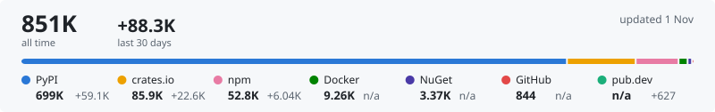

# Hi there! I'm Steven, by the way.
This is my personal GitHub for side projects and experiments. Currently tinkering with architecture model derivation, the occasional ethical hacking and maintaining a graph database ecosystem. 

## About Me

💻 Recreational programmer. I code for fun, to build and learn. 

🌱 Mostly Python and Rust.

🔭 Interested in architecture, optimization, robotics and (home) automation.

🔚 But enough **About Me**.

## Projects

<pre>
┏━━ 🗺️ <b>Architecture</b>
┃   ┗━━ <a href="https://github.com/StevenBtw/deriva">deriva</a>              - ArchiMate model derivation
┃    
┣━━ 📉 <b>Optimization</b>
┃   ┣━━ <a href="https://github.com/StevenBtw/solvOR">solvOR</a>              - Pure Python optimization solvers
┃   ┗━━ <a href="https://github.com/StevenBtw/benchmORk">benchmORk</a>           - OR solver benchmarking
┃   
┣━━ 🌌 <b>Anywidgets</b>
┃   ┣━━ <a href="https://github.com/GrafeoDB/anywidget-graph">anywidget-graph</a>     - Graph visualization for notebooks
┃   ┣━━ <a href="https://github.com/GrafeoDB/anywidget-vector">anywidget-vector</a>    - 3D vector visualization
┃   ┗━━ <a href="https://github.com/StevenBtw/anywidget-archimate">anywidget-archimate</a> - ArchiMate viewer for notebooks
┃      
┗━━ 🎡 <b>Grafeo Ecosystem</b>
    ┣━━ <a href="https://github.com/GrafeoDB/grafeo">grafeo</a>              - Embeddable graph database
    ┣━━ <a href="https://github.com/GrafeoDB/grafeo-web">grafeo-web</a>          - Browser-based via WASM 
    ┣━━ <a href="https://github.com/GrafeoDB/grafeo-server">grafeo-server</a>       - HTTP server & web UI
    ┣━━ <a href="https://github.com/GrafeoDB/grafeo-memory">grafeo-memory</a>       - AI memory layer for agents
    ┣━━ <a href="https://github.com/GrafeoDB/grafeo-mcp">grafeo-mcp</a>          - MCP server for AI agents
    ┣━━ <a href="https://github.com/GrafeoDB/grafeo-langchain">grafeo-langchain</a>    - LangChain integration
    ┣━━ <a href="https://github.com/GrafeoDB/grafeo-llamaindex">grafeo-llamaindex</a>   - LlamaIndex integration
    ┣━━ <a href="https://github.com/GrafeoDB/graph-bench">graph-bench</a>         - Graph database benchmark
    ┣━━ <a href="https://github.com/GrafeoDB/boltr">boltr</a>               - Bolt v5.x wire protocol
    ┗━━ <a href="https://github.com/GrafeoDB/gql-wire-protocol">gwp</a>                 - GQL Wire Protocol (gRPC)
</pre>

<!-- Card variants by README column width: xs under 460px, sm to 600px, md to 760px, full card above.
     GitHub's column narrows again at 768px and 1012px wide screens (sidebar), hence two ranges for xs. -->
<picture>
  <source media="(max-width: 556px) and (prefers-color-scheme: dark), (min-width: 768px) and (max-width: 844px) and (prefers-color-scheme: dark)" srcset="assets/downloads-xs-dark.svg">
  <source media="(max-width: 556px), (min-width: 768px) and (max-width: 844px)" srcset="assets/downloads-xs-light.svg">
  <source media="(max-width: 1048px) and (prefers-color-scheme: dark)" srcset="assets/downloads-sm-dark.svg">
  <source media="(max-width: 1048px)" srcset="assets/downloads-sm-light.svg">
  <source media="(max-width: 1208px) and (prefers-color-scheme: dark)" srcset="assets/downloads-md-dark.svg">
  <source media="(max-width: 1208px)" srcset="assets/downloads-md-light.svg">
  <source media="(prefers-color-scheme: dark)" srcset="assets/downloads-dark.svg">
  
</picture>

  <picture>
    <source media="(prefers-color-scheme: dark)" srcset="assets/bonsai-dark.svg">
    
  </picture>
   
  This bonsai tree reflects my GitHub activity. Want to know more? Check out <a href="https://github.com/marketplace/actions/gitbonsai">gitbonsai</a>.

